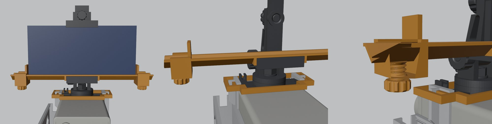

# Versão articulada do suporte do celular (anterior)

Antes do [suporte fixo com o clip](SUPORTE_CLIP.md), o celular ficava numa articulação com giro, inclinação e rolagem. As peças continuam no `.scad` e nas mesas abaixo. Para ver tudo montado, use `PART="montagem_articulada"`.

## Peças

| Peça | Arquivo em `stl/` | Mesa (`mesas/`) | Qtd |
|---|---|---|---|
| Cabo, ponte do topo, garfo, braço, garra e mordente | `cabo.stl`, `topo.stl`, `garfo.stl`, `braco.stl`, `garra.stl`, `mordente.stl` | `3_cabo_e_articulacao_PLA.3mf` | 1 de cada |
| Parafuso e porca-botão da inclinação, parafuso-botão da rolagem, parafusos de trava do giro e do mordente, porca e arruela em D do giro, chave do cabo | `parafusos.stl` | `4_parafusos_PLA.3mf` | 8 peças |
| Trava lateral do celular: calha, 2 cursores e 2 botões | `trava_celular.stl` | `6_trava_celular_PLA.3mf` | 5 peças |

Nessa versão, a mesa `3_cabo_ponte_chave_PLA.3mf` e o clip não são usados.

## Como prende

| Parte | Como prende |
|---|---|
| **Giro, inclinação e rolagem** | Parafusos, porcas e botões impressos, com rosca de 8 mm e passo de 2 mm. A rosca é direita (aperta no sentido horário). |
| **Celular** | Garra com mordente que desliza e trava. A abertura (lado menor + espessura do celular) vai de ~68 a ~88 mm; o S21 dá 71,2 + 7,9 = 79,1 mm. Uma trava lateral com 2 cursores segura o celular nas pontas, para celulares de ~140 a ~172 mm de comprimento. Veja [como funciona](img/como_funciona_trava_celular.png). |

## Montagem

Os passos 1 a 4 (cabo, câmera, power bank, ponte e trava da ponte) e o da EasyCap são os mesmos do [README](../README.md#montagem). No lugar do clip:

1. **Giro:**
   - Coloque o garfo no pino, a arruela com furo em D e a porca sextavada.
   - Aperte até o garfo girar firme.
   - Rosqueie o parafuso da trava do giro na orelha da frente do garfo.
2. **Inclinação:**
   - Ponha o braço entre as orelhas do garfo.
   - Passe o parafuso pela orelha **direita**, com a face plana para cima, encaixando no furo em D.
   - Rosqueie a porca-botão do lado esquerdo.
3. **Rolagem:** encoste a garra atrás do braço e passe o parafuso-botão pela frente do braço, rosqueando na garra.
4. **Trava do celular e celular:**
   - Enfie um cursor em cada ponta da calha, com os botões para baixo e as paredes viradas para o meio.
   - Rosqueie um botão em cada cursor.
   - Encaixe a calha no V da garra de baixo, com os dedos abraçando as pontas da garra.
   - Ponha o celular com o USB-C para a esquerda.
   - Encoste os cursores nas pontas do celular e aperte os botões.
   - Enfie o mordente pelo topo da espinha, desça até encostar no celular e aperte o botão do mordente com firmeza.

   

## Movimentos do celular

| Movimento | Faixa |
|---|---|
| Giro | 360° |
| Inclinação | −35° a +95° |
| Rolagem | ±30° |
| Inclinar para trás e rolar ao mesmo tempo | Com ±15° de rolagem, vai até −25°. Com ±30°, não incline para trás. |

## Verificações

```bash
bash tools/build6.sh asm_ topo berco tampa cabo chave porca trava_ponte garfo trava bincl braco garra brol mordente bmord trava_celular
python3 tools/check6.py          # colisões e movimentos
python3 tools/cog6.py            # centro de massa e estabilidade em pé
```

- **Colisões:** nenhuma entre as peças, nas faixas de movimento da tabela acima.
- **Equilíbrio:** o centro de massa fica a ~4 mm da mão.
- **Em pé:** o rig só tomba com mais de ~6° de inclinação.
